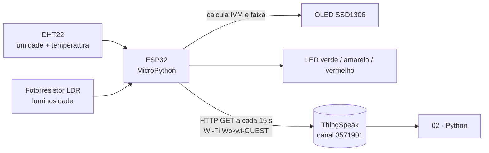
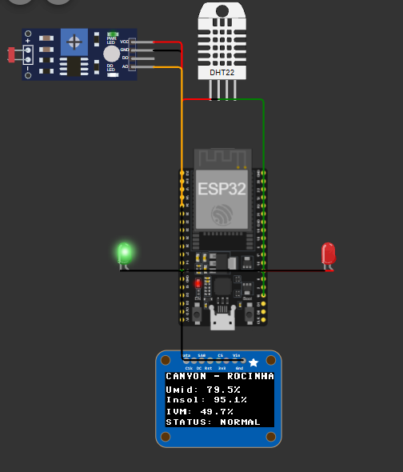
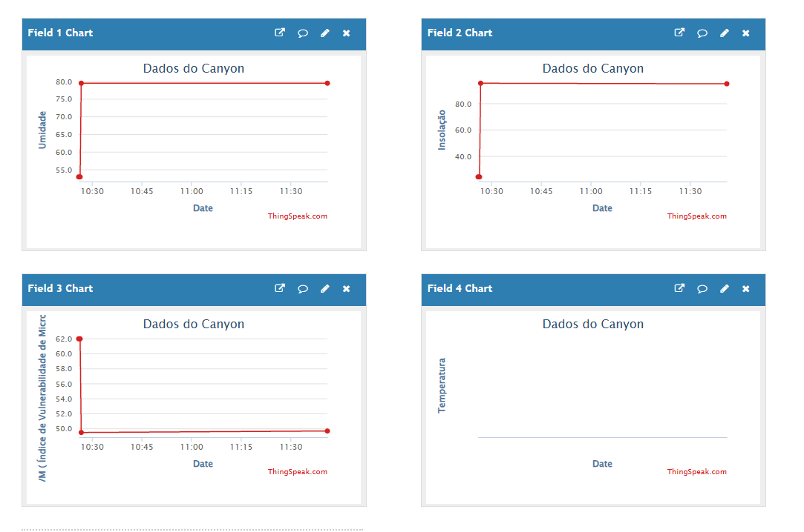

# 01 · Edge Computing & Computer Systems — Monitoramento com ESP32 e ThingSpeak

> **Disciplina:** Edge Computing & Computer Systems · **Atividade:** Monitoramento Inteligente com ESP32 e ThingSpeak
> **Projeto:** Viela Tech — CitizenTech FIAP Global Solution 2026.2

| | Link |
|---|---|
| Simulação no Wokwi | <https://wokwi.com/projects/480218232420257793> |
| Canal público no ThingSpeak | <https://thingspeak.mathworks.com/channels/3571901> |
| API de leitura (JSON) | <https://api.thingspeak.com/channels/3571901/feeds.json?results=20> |

## Problema

Nas vielas da Rocinha, as casas coladas e os becos estreitos criam um "efeito cânion": a luz do sol quase não chega e o ar circula pouco. Umidade alta e pouca insolação favorecem a permanência do *Mycobacterium tuberculosis* em ambientes fechados. A Rocinha registrou **372 casos de tuberculose por 100 mil habitantes** (2013), cerca de 4 vezes a média da cidade (fontes em [`../05-software-tx-design`](../05-software-tx-design/README.md)).

## Objetivo

Medir o microclima de uma viela de forma contínua e barata, calcular no próprio dispositivo um **Índice de Vulnerabilidade de Microclima (IVM)**, sinalizar o risco no local (OLED + LEDs) e publicar os dados na nuvem para o restante do Viela Tech (Python, Matemática e aplicação web).

> O IVM descreve **condições ambientais**. Ele não diagnostica tuberculose nem substitui avaliação de saúde.

## Como funciona

1. **Leitura** — o DHT22 entrega umidade relativa (%) e temperatura (°C); o LDR entrega luminosidade pelo ADC (0–4095). No módulo do Wokwi a tensão em `AO` **cai** quando há mais luz ([documentação do componente](https://docs.wokwi.com/parts/wokwi-photoresistor-sensor)), por isso a insolação é calculada como `100 − leitura/4095·100`.
2. **Processamento local** — `IVM = 0,6 · Umidade + 0,4 · (100 − Insolação)`.
3. **Alerta local** — a faixa acende um único LED e aparece no OLED.
4. **Transmissão** — `field1..field4` são enviados ao ThingSpeak a cada 15 s (intervalo mínimo do plano gratuito). Sem Wi-Fi, o dispositivo continua medindo e sinalizando e tenta reconectar no ciclo seguinte.

### Faixas de risco (iguais em todo o projeto)

| IVM | Faixa | LED | OLED |
|---|---|---|---|
| < 40 | NORMAL | verde (GPIO 2) | `STATUS: NORMAL` |
| 40 a < 70 | ATENÇÃO | amarelo (GPIO 5) | `STATUS: ATENCAO` |
| ≥ 70 | PERIGO | vermelho (GPIO 4) | `STATUS: PERIGO` |

### Campos do canal ThingSpeak

| Campo | Conteúdo | Unidade |
|---|---|---|
| `field1` | Umidade relativa | % |
| `field2` | Insolação (luminosidade normalizada) | % |
| `field3` | IVM calculado no ESP32 | % |
| `field4` | Temperatura | °C |

## Componentes e ligações

| Componente | Função | Pino do ESP32 |
|---|---|---|
| ESP32 DevKit C v4 | Microcontrolador com Wi-Fi | — |
| DHT22 | Umidade e temperatura | GPIO 15 (SDA/dados) |
| Módulo fotorresistor (LDR) | Luminosidade | GPIO 34 (AO, ADC) |
| Display OLED SSD1306 128×64 | Painel local | GPIO 21 (SDA), GPIO 22 (SCL) |
| LED verde + resistor 220 Ω | Faixa NORMAL | GPIO 2 |
| LED amarelo + resistor 220 Ω | Faixa ATENÇÃO | GPIO 5 |
| LED vermelho + resistor 220 Ω | Faixa PERIGO | GPIO 4 |

## Arquivos

| Arquivo | Conteúdo |
|---|---|
| [`main.py`](main.py) | Firmware MicroPython: leitura, IVM, faixas, OLED/LEDs e envio ao ThingSpeak |
| [`ssd1306.py`](ssd1306.py) | Driver do display OLED |
| [`diagram.json`](diagram.json) | Circuito do Wokwi |
| [`evidencias/`](evidencias/) | Capturas da simulação e do canal |

## Como executar

1. Abra o [projeto no Wokwi](https://wokwi.com/projects/480218232420257793). Para reproduzir do zero: crie um projeto **ESP32 · MicroPython** e copie `main.py`, `ssd1306.py` e `diagram.json`.
2. Em `main.py`, troque `SUA_WRITE_API_KEY` pela Write API Key do canal (a chave não fica no GitHub).
3. Clique em **Start**. O monitor serial mostra cada leitura e a resposta `ThingSpeak Resposta: 200 | entry_id: N`.
4. **Demonstração de alerta:** clique no DHT22 e suba a umidade; clique no LDR e diminua o *lux*. O IVM sobe, o OLED muda de `NORMAL` → `ATENCAO` → `PERIGO` e o LED correspondente acende. Exemplos: umidade 30 % e 1.000 lux → NORMAL; umidade 80 % e 500 lux → ATENÇÃO; umidade 95 % e 10 lux → PERIGO.
5. Os gráficos do canal ThingSpeak atualizam a cada envio.

## Evidências

| Simulação no Wokwi | Canal no ThingSpeak |
|---|---|
|  |  |

As capturas acima são da primeira versão do firmware (antes da faixa ATENÇÃO e do campo de temperatura). Em 17/11/2026 o canal tinha **4 leituras reais** (`last_entry_id: 4`), de 09/11/2026. Novas capturas devem ser feitas após rodar a versão atual (ver pendências).

## Beneficiários

- **Moradores das vielas**: alerta visual no próprio local sobre ambientes úmidos e escuros.
- **Agentes Comunitários de Saúde (ACS)**: priorizam visitas e orientações de ventilação.
- **Gestão de saúde (SMS-RJ / Clínicas da Família)**: dados históricos para planejar ações por setor.

## ODS

- **ODS 3 — Saúde e Bem-Estar** (meta 3.3: acabar com a epidemia de tuberculose).
- **ODS 10 — Redução das Desigualdades**: tecnologia barata para um território vulnerável.
- **ODS 11 — Cidades e Comunidades Sustentáveis**: dados para melhorar moradia, ventilação e iluminação.

## Segurança

- A Write API Key **não** é versionada. Uma versão anterior deste arquivo trazia a chave em texto puro; ela continua no histórico do Git e **deve ser regenerada** no ThingSpeak (*API Keys → Generate New Write API Key*).
- O canal é público e contém apenas dados ambientais, nenhum dado pessoal.

## Pendências desta entrega (dependem da equipe)

- [ ] Atualizar o projeto online do Wokwi com o `main.py` e o `diagram.json` desta pasta.
- [ ] Regenerar a Write API Key e colá-la apenas no Wokwi.
- [ ] Rodar a simulação por pelo menos 5 minutos (≥ 20 envios) variando os sensores, e substituir as capturas em `evidencias/` mostrando o OLED em ATENÇÃO/PERIGO, o monitor serial com `200` e o `field4` preenchido.

## Integrantes

Miguel Menezes Montalvão dos Santos (RM 573825) · Pedro Lucas Souza Provadelli (RM 572547) · Vitor Louzano Gomes Mendes (RM 573885)
