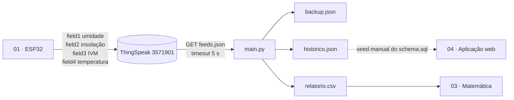

# 02 · Computational Thinking with Python — O Cérebro Conectado

> **Disciplina:** Computational Thinking with Python · **Atividade:** O Cérebro Conectado
> **Projeto:** Viela Tech — CitizenTech FIAP Global Solution 2026.2

Programa de terminal que busca as leituras do ESP32 no ThingSpeak, guarda backup e histórico, calcula o **Índice de Vulnerabilidade de Microclima (IVM)** de cada leitura, analisa risco e tendência e exporta um relatório CSV. O CSV gerado aqui é a entrada do modelo de [Matemática](../03-matematica-modelagem/README.md).

> O IVM descreve condições ambientais da viela. Ele não diagnostica tuberculose.

## Como executar

Requisitos: Python 3.10 ou superior.

```bash
cd 02-python-processamento
python -m venv .venv
# Windows: .venv\Scripts\activate   |   Linux/macOS: source .venv/bin/activate
python -m pip install -r requirements.txt
python main.py
```

### Menu

| Opção | O que faz |
|---|---|
| `[1]` Buscar e processar | Pede até 100 leituras ao ThingSpeak (`results=100`, mínimo exigido: 20), valida, calcula IVM e faixa, atualiza `backup.json` e acrescenta ao `historico.json` só o que é novo. Sem internet, usa o backup. |
| `[2]` Análise de risco | Contagem por faixa, tendência de piora, maior episódio contínuo em PERIGO e último IVM. |
| `[3]` Exportar CSV | Grava `relatorio.csv` com cabeçalho (UTF-8 com BOM, abre direto no Excel). |
| `[4]` Sair | Encerra o loop. `Ctrl+C` também encerra sem erro. |

### Testes

```bash
python -m unittest -v test_main
```

São 22 testes, que não acessam a rede (a API é simulada com `unittest.mock`). Eles cobrem:

- normalização e cálculo do IVM, incluindo os limites configurados;
- `ValueError` para configuração inválida;
- bordas das faixas (39,99 / 40 / 69,99 / 70);
- tendência e maior episódio em PERIGO;
- histórico sem duplicatas;
- backup quando a API cai, devolve erro HTTP ou feed vazio;
- temperatura preservada;
- CSV com cabeçalho.

## Arquivos

| Arquivo | Conteúdo |
|---|---|
| [`main.py`](main.py) | Programa principal |
| [`test_main.py`](test_main.py) | Testes automáticos (unittest) |
| [`backup.json`](backup.json) | Última resposta válida da API, já processada. É usado quando a API falha. |
| [`historico.json`](historico.json) | Todas as leituras já vistas, sem repetição de `entry_id` |
| [`relatorio.csv`](relatorio.csv) | Exportação da opção 3 |
| [`prompts.md`](prompts.md) | Prompts de IA usados nesta entrega |
| [`requirements.txt`](requirements.txt) | Dependência: `requests` |

## Integração com o restante do projeto



O Python **recalcula** o IVM a partir de `field1` e `field2` em vez de confiar no `field3`. Assim a regra fica auditável em um só lugar, e uma leitura corrompida no caminho não passa adiante.

## Como o código atende a atividade

| Requisito | Onde está |
|---|---|
| Menu em loop com saída | `menu()`: `while True` com opção 4 |
| Funções com type hints, docstrings e uma responsabilidade cada | Todas as funções do `main.py` |
| Dicionários e configuração centralizada | `CONFIGURACAO` (API, limites, pesos, limiares, tendência) |
| ≥ 20 leituras, ≥ 2 campos | `results=100`. Usa umidade (`field1`), insolação (`field2`) e temperatura (`field4`) |
| Timeout, verificação HTTP, `RequestException` | `buscar_leituras()`: `timeout=5`, `raise_for_status()`, `except requests.exceptions.RequestException` |
| Backup automático e uso do backup na falha | `buscar_leituras()`. O backup só é substituído quando chegam dados válidos |
| Histórico sem duplicação (`entry_id` + `set`) | `atualizar_historico()`: `ids_existentes: set[str]` |
| CSV com cabeçalho | `exportar_csv()`: `csv.DictWriter` + `writeheader()` |
| Normalização e índice de risco | `normalizar()` e `calcular_ivm()` |
| `ValueError` para configuração inválida | `validar_configuracao()`, chamada ao iniciar o `menu()` |
| Classificação NORMAL / ATENÇÃO / PERIGO | `classificar_risco()` |
| Tendência após três altas seguidas | `analisar_leituras()`: `leituras_para_tendencia = 3` |
| Maior episódio em PERIGO e contagem por faixa | `analisar_leituras()` |

## Metodologia do índice

**1. Normalização mín–máx** (cada medida vai para 0–100):

```
nivel = (valor − min) / (max − min) × 100      limitado a [0, 100]
```

**2. Índice de risco** (soma ponderada, pesos somando 1):

```
nivel_umidade     = normalizar(umidade, 0, 100)
nivel_falta_luz   = 100 − normalizar(insolação, 0, 100)
IVM = 0,6 × nivel_umidade + 0,4 × nivel_falta_luz
```

**3. Classificação:** `IVM < 40` NORMAL · `40 ≤ IVM < 70` ATENÇÃO · `IVM ≥ 70` PERIGO.

### Justificativa dos limites, pesos e limiares

- **Limites 0–100 %.** São a faixa física dos sensores: o DHT22 mede umidade relativa de 0 a 100 %, e o ESP32 já converte o LDR para 0 a 100 %. Usar a faixa física mantém o IVM do Python **idêntico** ao calculado no ESP32, na Matemática e no app, que é a regra RN-01 do projeto. Para calibrar uma viela específica (por exemplo, umidade de 40 a 95 %), basta mudar `CONFIGURACAO["limites"]`. A validação recusa `min ≥ max`.
- **Insolação invertida.** O risco cresce com a **falta** de sol, pois a radiação UV e a ventilação reduzem a sobrevivência do bacilo da tuberculose em ambientes fechados. Por isso entra `100 − nível de insolação`.
- **Pesos 0,6 e 0,4.** A umidade recebe peso maior por ser medida continuamente e de forma direta pelo DHT22. A insolação do LDR é mais sensível à posição do sensor e a sombras momentâneas. Os pesos somam 1, o que mantém o índice em 0–100.
- **Limiares 40 e 70.** Dividem a escala em três faixas de ação (semáforo). Com ar úmido (≥ 70 %) **e** pouca luz (≤ 30 %), o IVM ultrapassa 70 e vira PERIGO. Uma só condição desfavorável tende a cair em ATENÇÃO.
- **Limitação.** Os pesos e limiares são uma **hipótese de projeto**, não uma calibração epidemiológica validada. Calibrar com dados reais de casos é um passo do roadmap.

## Evidência de execução

Execução real em **17/11/2026** contra o canal público 3571901. Comandos usados: `[1]`, `[2]`, `[3]` e `[4]`.

```text
=== Viela Tech | Monitoramento de Microclima ===
Escolha uma opção: 4 leitura(s) obtida(s) de ThingSpeak; 0 nova(s) adicionada(s) ao histórico.
Histórico acumulado: 4 leitura(s).

--- Análise de risco e tendência ---
Leituras analisadas: 4
Aviso: menos de 20 leituras no histórico.
NORMAL: 0
ATENÇÃO: 4
PERIGO: 0
Tendência: ESTÁVEL/SEM PIORA CONFIRMADA
Maior episódio contínuo em PERIGO: 0 leitura(s)
Último IVM: 49.7 (ATENÇÃO)

Relatório exportado: ...\02-python-processamento\relatorio.csv (4 linha(s)).
Até logo!
```

Teste do plano B, com a API apontada para um endereço inexistente:

```text
API indisponível ou resposta inválida (HTTPSConnectionPool(host='api.thingspeak.invalid', ...)). Usando backup local.
4 leitura(s) obtida(s) de backup offline; 0 nova(s) adicionada(s) ao histórico.
```

`relatorio.csv` gerado:

```csv
entry_id,created_at,umidade,temperatura,insolacao,ivm,faixa_risco
1,2026-11-09T13:26:01Z,53.0,,24.444444,62.0,ATENÇÃO
2,2026-11-09T13:26:27Z,53.0,,24.444444,62.0,ATENÇÃO
3,2026-11-09T13:26:47Z,79.5,,95.531132,49.5,ATENÇÃO
4,2026-11-09T14:41:09Z,79.5,,95.091576,49.7,ATENÇÃO
```

### Situação dos dados

- O canal tinha **apenas 4 leituras reais** em 17/11/2026 (`last_entry_id: 4`, de 09/11/2026). O código já pede até 100, mas a atividade exige no mínimo **20**. A equipe precisa rodar a simulação do Wokwi por pelo menos 5 minutos (um envio a cada 15 s) e depois executar de novo as opções 1 e 3.
- As leituras 1 a 4 vieram da primeira versão do firmware, que tratava o LDR ao contrário: a insolação registrada era, na prática, a falta de luz. O firmware atual ([`../01-edge-computing-esp32`](../01-edge-computing-esp32/README.md)) já corrige isso. O campo `temperatura` passou a ser enviado depois dessas leituras, por isso está vazio no CSV.

## Integrantes

Miguel Menezes Montalvão dos Santos (RM 573825) · Pedro Lucas Souza Provadelli (RM 572547) · Vitor Louzano Gomes Mendes (RM 573885)
