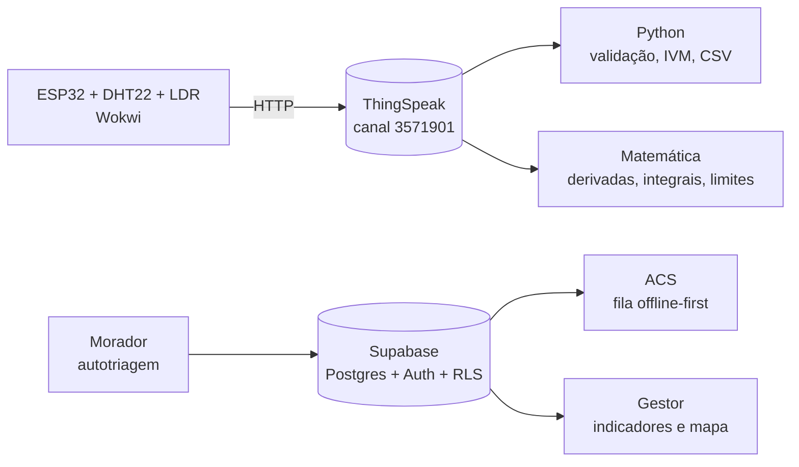

# 05 · Software & Total Experience Design

> **FIAP · Engenharia de Software · Global Solution 2026.2 (CitizenTech)**
> **Projeto:** Viela Tech, inteligência urbana e vigilância em saúde para a prevenção da tuberculose na Rocinha (RJ)
> **Turma:** 1ESSRA · ODS 3, 10 e 11

| Integrante | RM |
|---|---|
| Miguel Menezes Montalvão dos Santos | 573825 |
| Pedro Lucas Souza Provadelli | 572547 |
| Vitor Louzano Gomes Mendes | 573885 |

**Arquivo para enviar:** [`VielaTech-SoftwareTX-Relatorio.pdf`](VielaTech-SoftwareTX-Relatorio.pdf), o relatório único de 21 páginas. Ele reúne a capa com os nomes, o índice, o backlog original (seções 1 a 10) e as seções 11 a 13: escopo e justificativa, status da implementação e conclusão, geradas a partir deste README.

**Fonte do backlog:** [`VielaTech-Backlog.pdf`](VielaTech-Backlog.pdf), mantido sem alteração, com 16 páginas: capa, sumário, problema, solução e arquitetura, linguagem visual, personas, regras de negócio, requisitos, backlog MoSCoW, rastreabilidade, roadmap, riscos e referências.

Para regenerar o relatório depois de editar este README: `python ferramentas/gerar_relatorio_unico.py .` (requer `pymupdf`).

Este README complementa o PDF em três pontos:

- o **escopo** do produto, de forma explícita;
- o **status real de implementação** de cada requisito e história, com o arquivo que comprova;
- a **conclusão**.

O PDF foi mantido sem alteração. As histórias novas estão em [`VielaTech-Backlog.md`](VielaTech-Backlog.md).

## Índice

1. [Escopo](#1-escopo)
2. [Problema e justificativa](#2-problema-e-justificativa)
3. [Solução proposta](#3-solução-proposta)
4. [Regras de negócio](#4-regras-de-negócio)
5. [Requisitos funcionais](#5-requisitos-funcionais)
6. [Requisitos não funcionais](#6-requisitos-não-funcionais)
7. [Backlog do produto e status](#7-backlog-do-produto-e-status)
8. [Experiência (TX) e acessibilidade](#8-experiência-tx-e-acessibilidade)
9. [Conclusão](#9-conclusão)

Legenda de status: Implementado · Parcial · Não implementado · Fora do escopo (WON'T)

---

## 1. Escopo

**Dentro do escopo (MVP acadêmico):**

- Sensor de microclima simulado no Wokwi (ESP32 + DHT22 + LDR) publicando umidade, insolação, temperatura e IVM no ThingSpeak.
- Processamento em Python (consumo da API, validação, normalização, classificação, histórico, backup e CSV) e modelagem matemática (derivadas, integrais e limites).
- Aplicação web com três perfis (morador, ACS e gestor), autenticação e RLS no Supabase, fila de visitas offline-first e painel com indicadores agregados.
- Mapa público da tuberculose no Rio, só com dados de fonte citada.

**Fora do escopo:**

- Diagnóstico clínico. A triagem orienta; não diagnostica.
- Notificações automáticas por WhatsApp (US-15, WON'T). O boletim só gera um link de compartilhamento manual.
- Hardware físico instalado nas vielas e calibração do IVM com sensores reais em campo.
- Integração com sistemas oficiais da SMS-RJ (e-SUS, SINAN).
- Geolocalização de moradores ou exibição de endereços.

## 2. Problema e justificativa

A Rocinha registrou 372 casos de tuberculose por 100 mil habitantes em 2013. No mesmo ano, a taxa do município do Rio foi de 89,7 (Betim, *El País Brasil*, 2015).

Becos estreitos formam cânions urbanos: pouco sol, pouca ventilação e muita umidade. Três problemas se somam:

- **diagnóstico tardio:** quem mora longe adia a procura pela Atenção Primária;
- **dados desconectados:** o microclima não é cruzado com os sintomáticos;
- **falta de sinal:** nos pontos mais fundos, o trabalho digital do ACS é interrompido.

A evidência que sustenta o produto: depois da abertura de uma via com sol e ventilação, os casos entre os moradores dessa rua chegaram a zero (Betim, 2015). Luz e ventilação são variáveis de saúde.

## 3. Solução proposta

Uma cadeia única, do sensor no beco à decisão do gestor:

O diagrama não tem ligação entre o ThingSpeak e a tabela `leituras_microclima` do Supabase porque essa carga ainda **não é automática** (ver US-01).

## 4. Regras de negócio

| ID | Regra | Status | Evidência |
|---|---|---|---|
| RN-01 | IVM = 0,6·U + 0,4·(100 − I), com as faixas Normal < 40 ≤ Atenção < 70 ≤ Perigo. A falta de insolação foi fixada como `100 − I`, como o PDF recomendava. | Implementado | `01-edge-computing-esp32/main.py`, `python/main.py`, `03-matematica-modelagem/modelo_calculo.py`, `04-aplicacao-web/src/domain/risco.js` (mesma fórmula nos quatro) |
| RN-02 | Tosse por 21 dias ou mais gera prioridade alta | Implementado | `src/domain/risco.js`, gatilho em `supabase/schema.sql`, testes em `src/domain/domain.test.js` |
| RN-03 | Privacidade (LGPD): só dados agregados no público, consentimento, exclusão | Implementado | RLS em `supabase/schema.sql`, consentimento em `TriagemForm.jsx`, exclusão em `MinhaAreaPage.jsx`, `/privacidade` |
| RN-04 | Persistência local do ACS sem rede | Implementado | `src/services/api.js` (fila no `LocalStorage`), `src/services/sincronizacao.js` |

## 5. Requisitos funcionais

| ID | O sistema deve… | Status | Evidência / observação |
|---|---|---|---|
| RF-01 | Consumir umidade e insolação do ESP32/ThingSpeak | Parcial | O Python consome a API (`python/main.py`). O app lê `leituras_microclima`, mas a carga ThingSpeak → Supabase ainda é manual. |
| RF-02 | Autotriagem em até 4 etapas | Implementado | `TriagemForm.jsx`: 3 perguntas e o consentimento, com indicador "x de 3 respostas" |
| RF-03 | Indicar os pontos de coleta | Parcial | `src/domain/unidades.js` lista as 2 unidades de referência. Não há ordenação por distância. |
| RF-04 | Chamados com status dinâmico | Implementado | `src/domain/chamados.js`: `PENDENTE → EM_ANDAMENTO → COLETADO → CONCLUÍDO` |
| RF-05 | Painel com indicadores e mapa de risco | Implementado | `src/pages/GestorPage.jsx`, `MapaRocinha.jsx` (agregado por sub-área) |
| RF-06 | Acesso seguro de ACS e gestor | Implementado | Supabase Auth + papel em `perfis` + `ProtectedRoute.jsx` + RLS |

## 6. Requisitos não funcionais

| ID | Requisito | Status | Evidência / observação |
|---|---|---|---|
| RNF-01 | WCAG 2.1 AA, toque ≥ 48 px, HTML semântico | Parcial | Alvos de 48 px (`min-h-toque`), foco visível, `aria-*`, contraste AA nos botões. Falta o controle de alto contraste e fonte ajustável (US-07). |
| RNF-02 | Página inicial em < 2 s no 3G | Parcial | Rotas sob demanda e imagens AVIF/WebP. A equipe registrou Lighthouse mobile de 94 a 99 em desempenho (ver `04-aplicacao-web/README.md`). A medição não foi refeita nesta auditoria. |
| RNF-03 | Funções do ACS sem internet | Implementado | Fila offline e sincronização automática. Limitação: não há *service worker*, então o app precisa ter sido aberto antes com internet. |
| RNF-04 | Android 8.0+ e iOS | Não implementado | Layout responsivo testado a partir de 360 px no navegador. Não houve teste em aparelhos reais. |

## 7. Backlog do produto e status

Priorização MoSCoW do PDF (15 histórias), mais duas histórias adicionadas durante a implementação.

### E1 · Telemetria ambiental

| História | Prioridade | Status | Evidência / observação |
|---|---|---|---|
| US-01 Coleta dos sensores ESP32 | MUST | Parcial | O ESP32 publica no ThingSpeak e o Python consome, com fallback. Não grava em `leituras_microclima` automaticamente. |
| US-02 Cálculo automático do IVM | MUST | Implementado | Testes nas fronteiras 40/70 em `python/test_main.py` e `src/domain/domain.test.js`. Sentido de Iₙ documentado. |
| US-03 Histórico e backup | SHOULD | Implementado | `historico.json` e `backup.json`. Com a API fora do ar, usa o backup (testado com mock). |
| US-04 Exportação CSV | COULD | Parcial | `relatorio.csv` com data, umidade, insolação, temperatura, IVM e risco. Não tem setor nem filtro por período. |

### E2 · Autotriagem do morador

| História | Prioridade | Status | Evidência / observação |
|---|---|---|---|
| US-05 Formulário de autotriagem | MUST | Implementado | `TriagemForm.jsx`: tosse, febre e suor noturno; tosse ≥ 21 dias gera prioridade alta; fluxo por teclado |
| US-06 Localizador de pontos de coleta | MUST | Parcial | Lista as unidades de referência sem ordenar por distância (decisão de não pedir localização, por privacidade) |
| US-07 Alto contraste e ampliação de texto | SHOULD | Não implementado | Não implementado. O contraste AA padrão está garantido, mas não existe o controle de um clique. |
| US-08 Tema claro/escuro | COULD | Implementado | `src/hooks/useTheme.js`: troca manual persistente. Diferença do critério: o padrão é o tema claro, e não o do sistema, por legibilidade sob sol. |

### E3 · Painel do ACS offline

| História | Prioridade | Status | Evidência / observação |
|---|---|---|---|
| US-09 Autenticação do ACS | MUST | Parcial | Login e papel implementados. A RLS libera a fila inteira para a equipe; ainda não há filtro por microárea. |
| US-10 Gestão de chamados por setor | MUST | Implementado | `src/domain/chamados.js` (urgentes no topo, em vermelho) e `ChamadosFilter.jsx` |
| US-11 Registro de coleta offline | MUST | Implementado | `api.js`, com o selo "Aguardando sincronização" em `ChamadoCard.jsx` |
| US-12 Sincronização automática | SHOULD | Implementado | `sincronizarPendenciasOffline()`: IDs gerados no cliente, a fila mantém as falhas e uma trava impede envios simultâneos |

### E4 · Dashboard epidemiológico

| História | Prioridade | Status | Evidência / observação |
|---|---|---|---|
| US-13 Painel de indicadores | MUST | Parcial | Indicadores agregados em `GestorPage.jsx`. A atualização é por consulta periódica (60 s no microclima), não por Realtime. |
| US-14 Mapa de calor combinado | SHOULD | Implementado | `MapaRocinha.jsx` com a paleta semafórica, sem pontos individuais |
| US-15 Notificações automáticas por WhatsApp | WON'T | Fora do escopo | Fora do MVP, como no PDF |

### Histórias adicionadas na implementação

| História | Prioridade proposta | Status | Evidência / observação |
|---|---|---|---|
| US-16 Simulador temporal de 24 h | COULD | Implementado | `BacterialSimulator.jsx` + `src/domain/simulacao.js` (testado). Cenário didático, rotulado como tal. |
| US-17 Boletim comunitário e WhatsApp | COULD | Implementado | `CommunityBulletin.jsx`: gera o texto e um link `wa.me` que o gestor compartilha manualmente |

**Por que a US-17 não contradiz a US-15:** a US-15 (WON'T) previa **notificações automáticas** pela API oficial de mensageria, com dados do exame de cada morador. A US-17 só monta um texto com dados ambientais agregados e abre o WhatsApp; quem decide enviar é a pessoa. Não há integração, envio automático nem dado pessoal.

**Resumo:** das 8 histórias MUST, 4 estão completas e 4 parciais (US-01, US-06, US-09 e US-13). As parciais funcionam no fluxo principal e têm a lacuna descrita acima.

## 8. Experiência (TX) e acessibilidade

- **Semáforo único:** as mesmas três cores e rótulos (Normal, Atenção, Perigo) aparecem no LED do ESP32, no OLED, no Python, no PDF de Matemática e no app. A cor sempre vem acompanhada de ícone e texto.
- **Linguagem simples:** os textos falam com o morador ("Não deu para abrir esta página", "Aguardando visita") e evitam termos clínicos.
- **Confiança:** cada número público tem fonte, ano e link, e todo valor simulado é identificado como "(simulado)".
- **Campo sem sinal:** o ACS continua trabalhando offline e vê o que está pendente de envio.
- **Privacidade visível:** há consentimento antes do envio, a política de privacidade é acessível em uma página e o morador pode excluir as próprias triagens.

## 9. Conclusão

O backlog guiou a construção. As histórias MUST que formam a cadeia de valor (sensor → IVM → triagem → fila do ACS → painel) estão funcionando, e a regra central (RN-01) é a mesma nos quatro módulos de código.

O principal risco apontado no PDF era um IVM não calibrado com a insolação no sentido errado. Esse sentido foi corrigido e testado, mas a **calibração com dados reais continua pendente**: o canal do ThingSpeak tem poucas leituras.

As próximas entregas, por ordem de valor:

1. Integração automática ThingSpeak → Supabase (fecha a US-01 e o RF-01).
2. RLS por microárea (US-09).
3. Controle de alto contraste e fonte (US-07).
4. Atualização em tempo real do painel (US-13).
5. Testes em aparelhos Android e iOS reais (RNF-04).

## Referências

As referências estão no PDF, capítulo 10: Anselmo (2026), Betim (2015), Lei 13.709/2018 (LGPD), ONU Brasil (ODS) e W3C WCAG 2.1.
