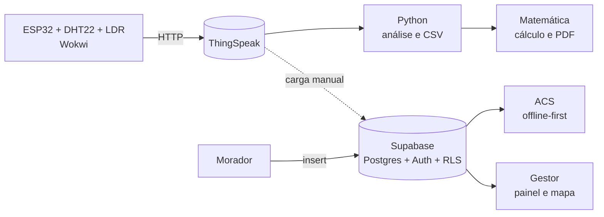
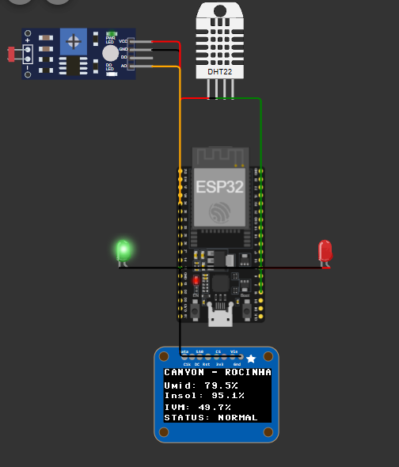
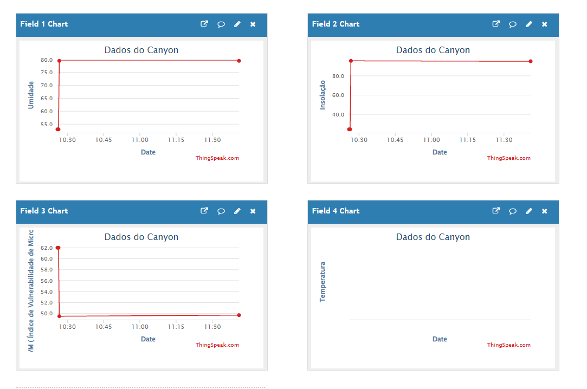
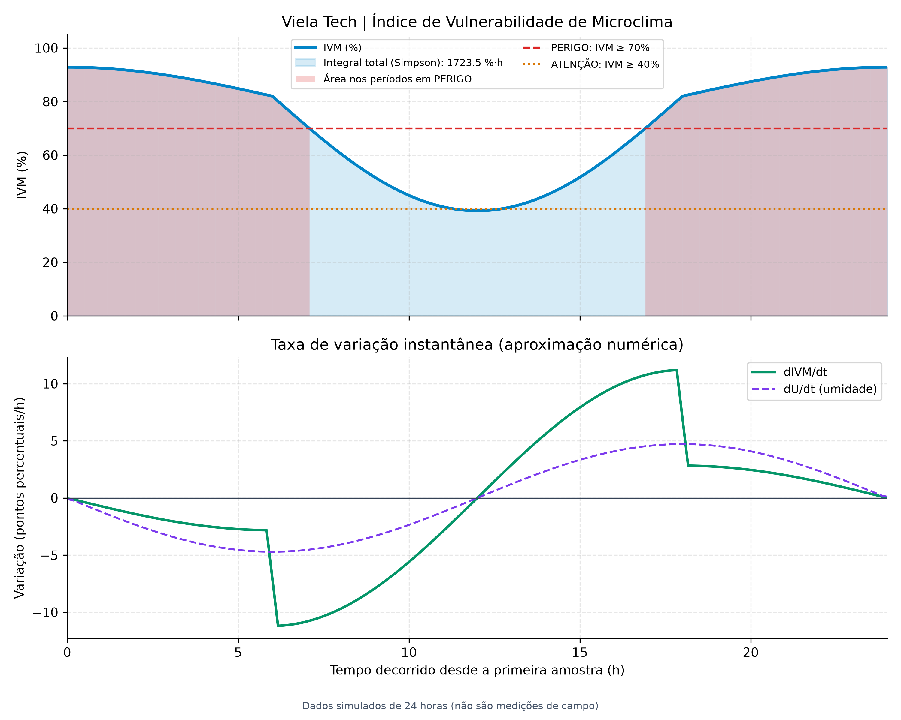

<div align="center">

<picture>
  <source media="(prefers-color-scheme: dark)" srcset="04-aplicacao-web/src/assets/brand/logo-horizontal-escuro.svg">
  
</picture>

### Onde o sol não chega, a saúde chega

Plataforma cívica de inteligência urbana e vigilância em saúde para a **prevenção da tuberculose na Rocinha (RJ)**. Um sensor mede o ar do beco, o morador faz a triagem pelo celular e o Agente Comunitário de Saúde recebe a fila de visitas na ordem certa, mesmo sem internet.

[](https://viela-tech-three.vercel.app)


[Aplicação](https://viela-tech-three.vercel.app) · [Simulação no Wokwi](https://wokwi.com/projects/480218232420257793) · [Canal ThingSpeak](https://thingspeak.mathworks.com/channels/3571901) · [Arquitetura](docs/arquitetura.md) · [Conformidade](docs/matriz-de-conformidade.md) · [Integrantes](Integrantes.md)

<br/>


<br/>

**FIAP · Engenharia de Software · Global Solution 2026.2: CitizenTech · Turma 1ESSRA**

</div>

---

## Visão geral

Nos becos da Rocinha o sol direto não chega ao chão e o ar quase não circula. A umidade fica, e isso favorece a tuberculose: em 2013 a comunidade registrou **372 casos por 100 mil habitantes**, cerca de **4 vezes** a taxa da cidade. Quem tosse há semanas demora a ser triado.

O Viela Tech liga **medição do ambiente** a **triagem e gestão**, em três passos:

1. **Medir:** um ESP32 lê umidade, luz e temperatura no beco e calcula o **IVM** (Índice de Vulnerabilidade de Microclima).
2. **Triar:** o morador responde a autotriagem no site; tosse há 21 dias ou mais vira prioridade.
3. **Agir:** o ACS atende a fila priorizada, e o gestor da SMS-RJ vê o risco por sub-área para decidir onde agir.

> O IVM descreve condições ambientais da viela. Ele não diagnostica tuberculose.

<table>
<tr>
<td width="33%" valign="top">

**🏠 Morador**

- Autotriagem com consentimento (LGPD)
- Resultado claro sobre procurar a Clínica da Família
- Histórico e exclusão das próprias triagens

</td>
<td width="33%" valign="top">

**🩺 Agente Comunitário (ACS)**

- Fila de visitas priorizada
- Muda o status do chamado em campo
- Funciona offline e sincroniza depois

</td>
<td width="33%" valign="top">

**📊 Gestor da SMS-RJ**

- Indicadores e mapa de calor da Rocinha
- Microclima e triagens agregadas por sub-área
- Simulador de 24 h e boletim para WhatsApp

</td>
</tr>
</table>

## Ficha da CitizenTech

| Campo | Resposta |
|---|---|
| **Nome da CitizenTech** | **Viela Tech** |
| **Cidade e bairro** | Rio de Janeiro (RJ), Rocinha: becos e vielas estreitos, com pouco sol e pouca ventilação |
| **Cidadão beneficiado** | Morador das vielas que está com tosse e não sabe se deve procurar a Clínica da Família. Também ajuda o Agente Comunitário de Saúde (ACS), que visita as famílias, e o gestor da Secretaria Municipal de Saúde. |
| **Problema, em uma frase** | Nos becos da Rocinha, a falta de sol e de ventilação mantém o ar úmido e parado, o que favorece a tuberculose, e quem tosse há semanas demora a ser triado e visitado. |
| **Como funciona** | Um sensor ESP32 mede umidade, luz e temperatura no beco e calcula o risco do ar (IVM). Os dados vão para o ThingSpeak e são analisados em Python e Matemática. No site, o morador faz a autotriagem; tosse há 21 dias ou mais vira prioridade na fila do ACS, que funciona mesmo sem internet. O gestor acompanha tudo de forma agregada. |
| **O que cada parte faz** | **Sensor (Edge):** mede o beco, acende o LED da faixa e envia ao ThingSpeak.<br>**Lógica (Python):** busca as leituras, calcula o IVM, percebe a piora, guarda o histórico e exporta o CSV.<br>**Matemática:** usa limites, derivadas e integrais para mostrar quando o risco sobe mais rápido e quanto ele se acumula no dia.<br>**Interface (Front-end):** o site em React onde o morador, o ACS e o gestor veem a informação.<br>**Interação (Web Dev):** a triagem com validação, a fila offline, o modo claro/escuro e o boletim no WhatsApp.<br>**Experiência (Software & TX):** personas, requisitos, regras de negócio e backlog priorizado.<br>**Pitch:** o vídeo de 3 minutos que conta a história do morador. |
| **Link do repositório** | [github.com/miguelMontalvao/Viela-Tech](https://github.com/miguelMontalvao/Viela-Tech) |
| **Indicador de impacto** | Dias de tosse até a triagem: o site já registra quantos dias de tosse a pessoa tem quando faz a triagem. A meta é baixar essa média e aumentar a parcela de triagens feitas antes de 21 dias, para que o exame chegue antes. |
| **ODS conectados** | **ODS 3 (Saúde e Bem-Estar):** triagem precoce da tuberculose (meta 3.3).<br>**ODS 10 (Redução das Desigualdades):** tecnologia de saúde para quem mora onde o serviço chega menos.<br>**ODS 11 (Cidades e Comunidades Sustentáveis):** o microclima do beco vira dado de planejamento urbano. |

**Links da entrega:**

| | |
|---|---|
| Aplicação web | [viela-tech-three.vercel.app](https://viela-tech-three.vercel.app) |
| Simulação ESP32 (Wokwi) | [wokwi.com/projects/480218232420257793](https://wokwi.com/projects/480218232420257793) |
| Canal público ThingSpeak | [thingspeak.mathworks.com/channels/3571901](https://thingspeak.mathworks.com/channels/3571901) |
| Código Python (análise do IVM) | [`02-python/`](02-python/README.md) |
| Relatório de Software & TX Design (PDF com timbrado) | [`05-software-tx-design/VielaTech-SoftwareTX-Relatorio.pdf`](05-software-tx-design/VielaTech-SoftwareTX-Relatorio.pdf) |
| Vídeo do pitch (YouTube) | pendente (ver [`06-pitch-storytelling/`](06-pitch-storytelling/README.md)) |

## Sumário

1. [Integrantes](#1-integrantes)
2. [Problema](#2-problema)
3. [Cidadão beneficiado](#3-cidadão-beneficiado)
4. [Solução](#4-solução)
5. [Como funciona](#5-como-funciona)
6. [Arquitetura](#6-arquitetura)
7. [Entregas por disciplina](#7-entregas-por-disciplina)
8. [Estrutura do repositório](#8-estrutura-do-repositório)
9. [O índice IVM](#9-o-índice-ivm)
10. [Como executar](#10-como-executar)
11. [Testes](#11-testes)
12. [Evidências](#12-evidências)
13. [Segurança e privacidade](#13-segurança-e-privacidade)
14. [Dados reais e simulados](#14-dados-reais-e-simulados)
15. [Impacto e ODS](#15-impacto-e-ods)
16. [Limitações e roadmap](#16-limitações-e-roadmap)
17. [Uso de IA e referências](#17-uso-de-ia-e-referências)

---

## 1. Integrantes

| Nome | RM |
|---|---|
| Miguel Menezes Montalvão dos Santos | 573825 |
| Pedro Lucas Souza Provadelli | 572547 |
| Vitor Louzano Gomes Mendes | 573885 |

Responsabilidades em [`Integrantes.md`](Integrantes.md).

## 2. Problema

Na Rocinha, os becos estreitos formam **cânions urbanos**: o sol direto não chega ao chão, o ar não circula e a umidade se acumula. Esse ambiente favorece a tuberculose.

Em 2013, a Rocinha registrou **372 casos por 100 mil habitantes**. Na cidade do Rio, a taxa foi de 89,7, ou seja, a Rocinha teve **4,1 vezes** mais casos (Betim, *El País Brasil*, 2015).

**Em uma frase:** a falta de sol e de ventilação nos becos cria um microclima de risco, e a triagem de quem tosse há semanas chega tarde.

## 3. Cidadão beneficiado

- **Morador das vielas** de baixa insolação: descobre se deve procurar a Clínica da Família, sem diagnóstico e sem deslocamento desnecessário.
- **Agente Comunitário de Saúde (ACS):** recebe a fila de visitas priorizada e trabalha mesmo sem sinal.
- **Gestor da SMS-RJ:** vê o microclima e as triagens agregadas por sub-área para decidir onde agir.

## 4. Solução

O Viela Tech liga um **sensor de microclima** a uma **aplicação web de triagem e gestão**:

1. Um ESP32 mede umidade, luz e temperatura no beco e calcula o **IVM** (Índice de Vulnerabilidade de Microclima).
2. Os dados vão para o ThingSpeak e são analisados em **Python** (tendência e relatório) e em **Matemática** (derivadas, integrais e limites).
3. Na aplicação web, o **morador** faz a autotriagem; tosse há 21 dias ou mais vira **prioridade**.
4. O **ACS** atende a fila na ordem certa, mesmo offline.
5. O **gestor** acompanha indicadores, mapa e microclima.

## 5. Como funciona

| Passo | O que acontece | Onde |
|---|---|---|
| 1 | O DHT22 e o LDR são lidos a cada 15 s; o ESP32 calcula o IVM, acende o LED da faixa e mostra no OLED | `01-edge-computing-esp32/` |
| 2 | A leitura é publicada no ThingSpeak (`field1` a `field4`) | canal 3571901 |
| 3 | O Python busca as leituras, valida, normaliza, classifica, detecta tendência de piora e exporta o CSV | `02-python/` |
| 4 | A Matemática modela o IVM no tempo, com limites, derivadas e integral do risco acumulado | `03-matematica-modelagem/` |
| 5 | O morador envia a triagem com consentimento; o banco marca a prioridade | `04-aplicacao-web/` + Supabase |
| 6 | O ACS muda o status (pendente → em atendimento → coletado → concluído), mesmo offline | `/acs` |
| 7 | O gestor vê indicadores, o mapa por sub-área, o simulador de 24 h e o boletim | `/gestor` |

## 6. Arquitetura



Detalhes, contrato de dados e camadas da aplicação: [`docs/arquitetura.md`](docs/arquitetura.md).

**Stack:**

- **Edge:** MicroPython no ESP32 (Wokwi).
- **Python:** Python 3.10+ com `requests`.
- **Matemática:** NumPy, SciPy, pandas e Matplotlib.
- **Web:** React 18, Vite 6, Tailwind CSS 3, React Router, Lucide e Vitest.
- **Backend e deploy:** Supabase (Postgres, Auth e RLS) e Vercel.

## 7. Entregas por disciplina

| # | Disciplina | Pasta | O que entrega |
|---|---|---|---|
| 1 | Edge Computing & Computer Systems | [`01-edge-computing-esp32/`](01-edge-computing-esp32/README.md) | Circuito no Wokwi, `main.py` com IVM, 3 faixas, LEDs, OLED e envio ao ThingSpeak |
| 2 | Computational Thinking with Python | [`02-python/`](02-python/README.md) | Consumo da API, validação, normalização, tendência, histórico, backup, CSV e 26 testes |
| 3 | Differentiated Problem Solving | [`03-matematica-modelagem/`](03-matematica-modelagem/README.md) | Limites, derivadas e integrais do IVM; PDF de 6 páginas; 16 testes |
| 4 | Front-end Design | [`04-aplicacao-web/`](04-aplicacao-web/README.md) | Aplicação React com 3 perfis, CRUD completo, acessibilidade e 36 testes |
| 5 | Software & Total Experience Design | [`05-software-tx-design/`](05-software-tx-design/README.md) | Relatório único em PDF com timbrado (personas, RN, RF, RNF, MoSCoW, rastreabilidade), escopo, status e conclusão |
| 6 | Storytelling & Inspiração Empreendedora | [`06-pitch-storytelling/`](06-pitch-storytelling/README.md) | Roteiro de 3 minutos com a demonstração real e checklist de gravação |
| 7 | Web Development | [`04-aplicacao-web/`](04-aplicacao-web/README.md#interações-em-javascript-web-development) | Interações em JavaScript, persistência no navegador e integração com a API do Supabase |

O status de cada requisito está em [`docs/matriz-de-conformidade.md`](docs/matriz-de-conformidade.md).

## 8. Estrutura do repositório

```text
Viela-Tech/
├── 01-edge-computing-esp32/   ESP32 MicroPython: main.py, ssd1306.py, diagram.json, evidencias/
├── 02-python/                 main.py, test_main.py, historico.json, backup.json, relatorio.csv, prompts.md
├── 03-matematica-modelagem/   modelo_calculo.py, relatorio_matematica.py, PDF, gráfico, testes
├── 04-aplicacao-web/          React + Vite + Tailwind + Supabase (src/, supabase/, public/)
├── 05-software-tx-design/     VielaTech-SoftwareTX-Relatorio.pdf (único PDF, com timbrado), README com escopo e status
├── 06-pitch-storytelling/     roteiro e checklist do vídeo
├── docs/                      arquitetura e matriz de conformidade
├── AI.md                      registro do uso de IA
├── Integrantes.md             equipe, RMs e responsabilidades
├── prompts.md                 índice dos prompts de IA por entrega
└── README.md                  este arquivo
```

A numeração segue a ordem das disciplinas do bimestre: a pasta `02-python/` guarda a entrega 2; a entrega 7 (Web Development) fica dentro de `04-aplicacao-web/`.

## 9. O índice IVM

```text
IVM = 0,6 × Umidade + 0,4 × (100 − Insolação)
```

| Faixa | IVM | Cor | Ação |
|---|---|---|---|
| **Normal** | abaixo de 40 | verde `#16A34A` | monitoramento de rotina |
| **Atenção** | de 40 a menos de 70 | âmbar `#D97706` | setor acompanhado pelo gestor |
| **Perigo** | 70 ou mais | vermelho `#DC2626` | busca ativa e visitas priorizadas |

- A umidade pesa mais (0,6) porque é a variável mais ligada à proliferação do patógeno.
- `100 − Insolação` representa a **falta** de sol.
- A mesma fórmula e as mesmas faixas estão no ESP32, no Python, na Matemática e no app.

O IVM é um **indicador ambiental didático** e não mede o risco clínico de uma pessoa.

## 10. Como executar

**Pré-requisitos:** Python 3.10+ e Node.js 18+.

```bash
# 1 · Edge: abra o link do Wokwi acima e clique em ▶ (ou copie os arquivos de 01-edge-computing-esp32/)

# 2 · Python
cd python
pip install -r requirements.txt
python main.py                 # menu: 1 buscar · 2 analisar · 3 exportar CSV · 4 sair

# 3 · Matemática
cd ../03-matematica-modelagem
pip install -r requirements.txt
python modelo_calculo.py       # gera grafico_microclima.png e Relatorio_Matematica.pdf

# 4 · Aplicação web
cd ../04-aplicacao-web
npm install
cp .env.example .env           # URL e chave anon do Supabase (opcional: sem .env roda em modo local)
npm run dev                    # http://localhost:5173
```

Como configurar o Supabase (schema, migração e usuários da equipe): [`04-aplicacao-web/README.md`](04-aplicacao-web/README.md#configurando-o-supabase).

## 11. Testes

Execução de 18/11/2026:

| Módulo | Comando | Resultado |
|---|---|---|
| Python | `python -m unittest test_main.py` | 26 de 26 passaram |
| Matemática | `python -m pytest test_modelo_calculo.py` | 16 de 16 passaram |
| Aplicação web | `npm test` | 36 de 36 passaram |
| Aplicação web | `npm run build` | build sem erros |
| Edge | `ast.parse` do `main.py` | sintaxe válida (a simulação roda no Wokwi) |

## 12. Evidências

| ESP32 no Wokwi | Campos no ThingSpeak |
|---|---|
|  |  |



As demais evidências estão nas pastas de cada entrega:

- a saída real do terminal Python está no [README do Python](02-python/README.md#evidência-de-execução);
- o relatório de Matemática é o [`Relatorio_Matematica.pdf`](03-matematica-modelagem/Relatorio_Matematica.pdf);
- a aplicação está publicada em [viela-tech-three.vercel.app](https://viela-tech-three.vercel.app).

## 13. Segurança e privacidade

- **RLS no Supabase:**
  - quem não tem conta só consegue **enviar** uma triagem, nunca ler;
  - o morador lê e exclui as próprias triagens;
  - ACS e gestor acessam a fila conforme o papel.
- **LGPD:** consentimento explícito antes do envio (art. 11, I), exclusão pelo próprio morador (art. 18) e coleta mínima (nome, setor e sintomas, sem endereço). A política fica em `/privacidade`.
- **No aparelho:** ao sair da conta, o cache local de chamados é apagado.
- **Segredos:** nenhuma chave no código. O `.env` é ignorado pelo git, e a chave do ThingSpeak é um marcador. A chave usada antes desta auditoria aparece no histórico e **deve ser trocada**.
- **Mapa público:** só números agregados de fontes citadas. O mapa por sub-área é restrito à equipe.

## 14. Dados reais e simulados

| Dado | Origem | Situação |
|---|---|---|
| Leituras do sensor | ThingSpeak, canal 3571901 | **reais (simuladas no Wokwi)**: 4 leituras (última em 09/11/2026, conferido em 18/11) |
| Gráfico e PDF de Matemática | simulação de 24 h identificada | o modelo passa a usar o CSV real quando houver 20 leituras ou mais |
| Taxas de tuberculose | Betim (2015) e boletim SMS-RJ (2023) | públicas, com fonte e ano na tela |
| Simulador de 24 h e boletim | leitura do sensor e cenário padrão | campos sem leitura aparecem como "(simulado)" |
| Foto da Home | ilustração gerada por IA | identificada no `AI.md` |

## 15. Impacto e ODS

- **Indicador de impacto:** tempo médio entre o início da tosse e a entrega do exame na Clínica da Família Rinaldo De Lamare.
- **ODS 3 (Saúde e Bem-Estar):** triagem precoce da tuberculose.
- **ODS 10 (Redução das Desigualdades):** tecnologia de saúde para quem mora onde a cidade não enxerga.
- **ODS 11 (Cidades e Comunidades Sustentáveis):** o microclima urbano como dado de planejamento.

## 16. Limitações e roadmap

**Limitações atuais:**

- A carga ThingSpeak → Supabase (`leituras_microclima`) ainda é manual.
- O canal tem poucas leituras, e a calibração do IVM com dados reais está pendente.
- Não há *service worker*: o modo offline funciona depois que o app foi aberto com internet.
- O ACS ainda vê a fila inteira, sem filtro por microárea.

**Próximos passos:**

1. Script agendado que copia as leituras do ThingSpeak para o Supabase.
2. RLS por microárea do ACS.
3. Controle de alto contraste e tamanho de fonte (US-07).
4. Painel em tempo real (Supabase Realtime).
5. Testes de usabilidade com moradores e ACS da Rocinha.

**Pendências da equipe para a submissão:** ver a [matriz de conformidade](docs/matriz-de-conformidade.md).

## 17. Uso de IA e referências

O uso de IA (Gemini, Codex e Claude Code), com os prompts e a forma de validação, está registrado em [`AI.md`](AI.md).

**Referências:**

- BETIM, Felipe. Tuberculose na Rocinha expõe o Brasil que estacionou no século XIX. *El País Brasil*, 12 set. 2015. [Republicação no IHU Unisinos](https://ihu.unisinos.br/noticias/546729-tuberculose-na-rocinha-expoe-o-brasil-que-estacionou-no-seculo-xix).
- RIO DE JANEIRO (Município). Secretaria Municipal de Saúde. [*Boletim Epidemiológico: Tuberculose no Município do Rio de Janeiro*](https://epirio.svs.rio.br/wp-content/uploads/2023/03/BOLETIM_epidemiologico_TUBERCULOSE_MIOLO_2023_FINAL_v2.pdf), 2. ed., mar. 2023.
- BRASIL. Lei nº 13.709, de 14 de agosto de 2018 (LGPD).
- W3C. Web Content Accessibility Guidelines (WCAG) 2.1, 2018.
- NAÇÕES UNIDAS BRASIL. [Objetivos de Desenvolvimento Sustentável](https://brasil.un.org/pt-br/sdgs).
