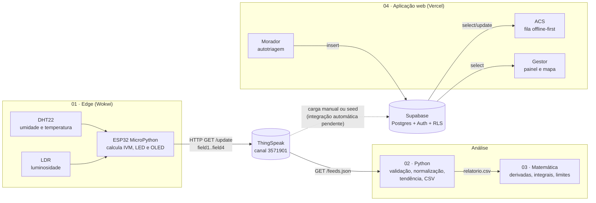
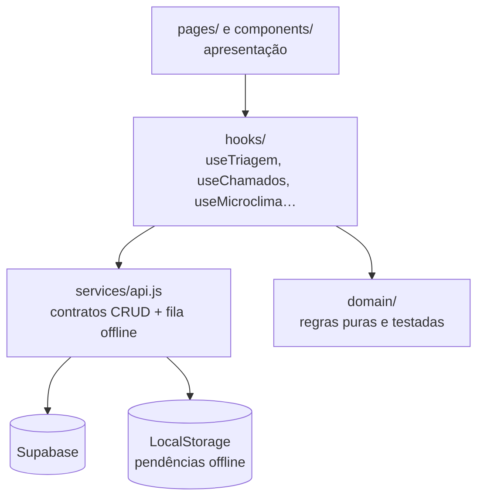

# Arquitetura e contrato de dados

Este documento descreve como as entregas do Viela Tech se conectam e quais dados passam entre elas.

## Visão geral



## Regra única do IVM

A mesma regra está implementada em quatro lugares:

| Onde | Arquivo |
|---|---|
| ESP32 | [`01-edge-computing-esp32/main.py`](../01-edge-computing-esp32/main.py) (`calcular_ivm`, `classificar_ivm`) |
| Python | [`python/main.py`](../python/main.py) (`calcular_ivm`, `classificar_risco`) |
| Matemática | [`03-matematica-modelagem/modelo_calculo.py`](../03-matematica-modelagem/modelo_calculo.py) |
| Aplicação web | [`04-aplicacao-web/src/domain/risco.js`](../04-aplicacao-web/src/domain/risco.js) (`calcularIVM`, `classificarIVM`) |

```text
IVM = 0,6 × Umidade + 0,4 × (100 − Insolação)        (0 a 100, 1 casa decimal)

NORMAL   IVM < 40          verde  #16A34A
ATENÇÃO  40 ≤ IVM < 70     âmbar  #D97706
PERIGO   IVM ≥ 70          vermelho #DC2626
```

`100 − Insolação` representa a **falta** de sol: menos luz significa mais risco. O IVM é um indicador ambiental didático e não mede risco clínico de tuberculose.

## ThingSpeak (canal público 3571901)

| Campo | Conteúdo | Unidade | Origem |
|---|---|---|---|
| `field1` | Umidade relativa | % (0–100) | DHT22 |
| `field2` | Insolação | % (0–100) | LDR, `100 − leitura/4095·100` |
| `field3` | IVM | % (0–100) | calculado no ESP32 |
| `field4` | Temperatura | °C | DHT22 |

O ESP32 envia uma leitura a cada 15 s, respeitando o limite de 15 s do plano gratuito.

## Supabase

| Tabela | Colunas principais | Quem lê | Quem escreve |
|---|---|---|---|
| `chamados_coleta` | `morador_nome`, `setor_viela`, `dias_tosse`, `tem_febre`, `tem_sudorese`, `prioridade_alta` (gatilho: tosse ≥ 21), `status`, `morador_id` | o morador lê as próprias; ACS e gestor leem todas | qualquer pessoa insere; ACS e gestor atualizam o status; o dono ou o gestor excluem |
| `leituras_microclima` | `umidade`, `insolacao`, `ivm`, `temperatura`, `created_at` | ACS e gestor | carga manual ou seed (integração pendente) |
| `perfis` | `id` (auth), `nome`, `papel` (`morador`, `acs` ou `gestor`) | cada um lê o próprio | gatilho na criação da conta; o papel só muda pelo painel do Supabase |

Ciclo do chamado: `PENDENTE → EM_ANDAMENTO → COLETADO → CONCLUÍDO`.

Esquema completo: [`04-aplicacao-web/supabase/schema.sql`](../04-aplicacao-web/supabase/schema.sql). Mudanças para bancos existentes: [`04-aplicacao-web/supabase/migracoes/`](../04-aplicacao-web/supabase/migracoes/).

## Camadas da aplicação web



- `domain/` não importa React nem Supabase, e por isso é testado com Vitest sem navegador.
- Os componentes não falam com o Supabase diretamente: tudo passa pelos hooks e pelo `api.js`.

## Segurança e privacidade

- **RLS em todas as tabelas.** O anônimo só pode **inserir** triagens, nunca ler.
- **Consentimento explícito** antes do envio da triagem e **exclusão** pelo próprio morador (LGPD, art. 11, I, e art. 18).
- **Ao sair da conta,** o cache local de chamados da equipe é apagado do aparelho.
- **Sem segredos no repositório.** A chave do ThingSpeak no `main.py` é um marcador (`SUA_WRITE_API_KEY`), e o `.env` da aplicação está no `.gitignore`.
- **O mapa público** usa só dados agregados de fontes citadas. O mapa por sub-área, feito com as triagens, é restrito à equipe.
